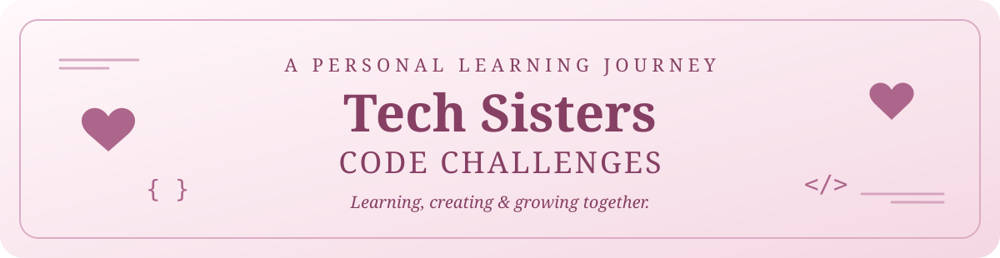

  

   

  
  
  

## 💗 Olá, sister!

Bem-vinda ao meu cantinho de desafios de programação! Aqui documento minhas soluções autorais para atividades propostas pela comunidade **Tech Sisters**, registrando o que pratiquei, o que descobri e como evoluo a cada desafio.

A proposta é aprender com curiosidade, compartilhar experiências e construir confiança através da prática. 🎀

### ☕ Desafios

| Desafio | Tema | Linguagem | Solução |
| :-- | :-- | :--: | :-- |
| **#02** | Informações do Usuário | Java | [Ver desafio e código](desafios/desafio-02-informacoes-do-usuario/README.md) |
| **#03** | Meta de Passos | Java | [Ver desafio e código](desafios/desafio-03-meta-de-passos/README.md) |

### ✨ Sobre esta jornada

- **Aprendizado prático:** cada exercício é uma oportunidade de reforçar conceitos.
- **Autoria:** os códigos representam meu processo de aprendizagem, incluindo escolhas que posso aprimorar depois.
- **Contexto:** junto de cada solução, guardo o enunciado e os objetivos do desafio, com crédito à comunidade.

---

## 🌷 About this repository

Welcome to my coding corner! This is my personal collection of solutions to coding challenges proposed by the **Tech Sisters** community. I document each challenge, my implementation, and the concepts I practiced while learning software development.

*Little challenges, big progress.* 💗

Projeto pessoal de estudos. As propostas dos desafios são de autoria da comunidade Tech Sisters; as soluções em código são minhas. Este não é um repositório oficial da comunidade.
