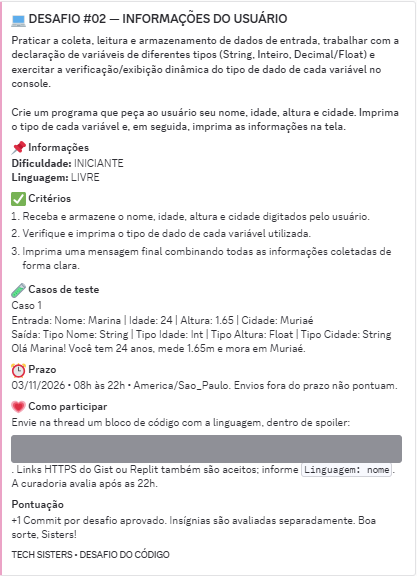

# 🎀 Desafio #02 — Informações do Usuário

> **Comunidade:** Tech Sisters · **Linguagem:** Java · **Nível:** Iniciante

## 💌 Enunciado original

A imagem abaixo é um recorte da publicação original da comunidade no Discord, preservada para contextualizar o exercício e dar crédito à autoria do desafio.

### 📌 Resumo do desafio

Construir um programa que peça **nome, idade, altura e cidade**, armazene esses dados, exiba os **tipos de cada variável** e, ao final, apresente uma mensagem com as informações coletadas.

**Conceitos praticados:** `Scanner`, `String`, `int`, `double`, entrada de dados, `while`, saída formatada e identificação de tipos.

## ☕ Minha solução em Java

**[Abrir `UserInfo.java`](UserInfo.java)**

Escrevi esta primeira solução de forma independente, utilizando os conteúdos estudados até agora. Acrescentei, por iniciativa própria, uma validação para impedir idades negativas.

### 🌸 Notas de aprendizagem

- Pratiquei a leitura de informações inseridas pelo usuário com `Scanner`.
- Utilizei `nextLine()` após `nextDouble()` para consumir a quebra de linha pendente.
- Mostrei dinamicamente o nome da classe de `String` com `getClass().getSimpleName()`.
- Para `int` e `double`, exibi os nomes dos tipos em texto fixo nesta primeira versão; isso **não é uma verificação dinâmica**, e pode ser melhorado em uma revisão futura.
- Organizei a mensagem final com `System.out.printf()`.

> Esta pasta documenta minha **primeira versão autoral**, inclusive os pontos que ainda quero aprimorar.

---

[← Voltar à página principal](../../README.md)

Créditos do desafio: comunidade Tech Sisters. Screenshot da publicação original reproduzido apenas para contextualização e atribuição.
